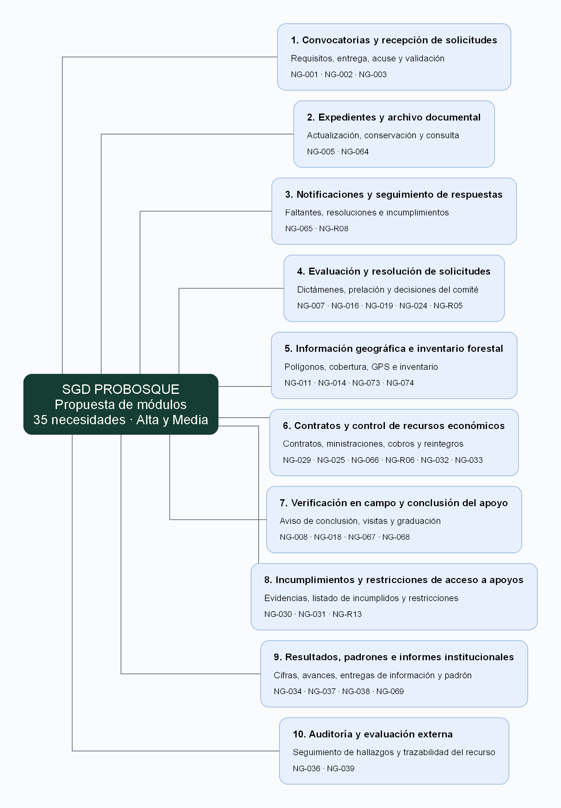

# Propuesta de solución por módulos — SGD PROBOSQUE

Clasificación funcional propuesta de las **35 necesidades de prioridad Alta o Media de las etapas 1 a 9**. Cada necesidad tiene un módulo principal y puede compartir información con otros módulos. El cruce relaciona necesidad, programa y fuente citada en la columna Origen de [TABLA_NECESIDADES.md](../TABLA_NECESIDADES.md#3-tabla-maestra).

Fecha de elaboración: 22 de noviembre de 2026.

## 1. Cuadro sinóptico de los 10 módulos

El expediente se comparte entre módulos. Contratos, minutas, comprobantes y resultados se vinculan con el expediente del predio correspondiente.

## 2. Programas y ámbitos

| Sigla | Programa |
|---|---|
| PSAH | Pago por Servicios Ambientales Hidrológicos |
| RHF | Restauración Hidrológico-Forestal |
| CC | Capturando Carbono |
| PS | Plantaciones Sustentables |
| MFS | Manejo Forestal Sustentable |
| PEG | Programa Estatal de Guardabosques |

La tabla de necesidades actual trata RFI (Restauración Forestal Integral) como modalidad de RHF. El inventario forestal, las funciones de UIPPE y la evaluación del programa presupuestario tienen un ámbito institucional propio.

## 3. Propuesta de solución y construcción general

Se propone una aplicación web con diez módulos. Los componentes tecnológicos se expresan de forma general para definir su función antes de seleccionar herramientas específicas.

| Módulo | Propuesta de solución | Cómo se hará, en términos generales |
|---|---|---|
| **1. Convocatorias y recepción de solicitudes** | Publicar requisitos, registrar solicitudes, emitir acuses y controlar faltantes. | **Formularios web** para capturar solicitudes y comprobar requisitos; **base de datos relacional** para relacionar programas, convocatorias, solicitudes y documentos; **generación de documentos** para emitir acuses. |
| **2. Expedientes y archivo documental** | Integrar, actualizar, conservar y consultar expedientes. | **Base de datos relacional** para vincular predios, personas, solicitudes y documentos; **almacenamiento de archivos** para documentos digitalizados y sus versiones; **consultas y filtros** para localizar expedientes. |
| **3. Notificaciones y seguimiento de respuestas** | Registrar avisos, entregas, respuestas y plazos. | **Flujo de seguimiento** con estados y fechas; **base de datos relacional** para conservar notificaciones y respuestas; **servicio de avisos** para informar pendientes y vencimientos; almacenamiento de constancias de entrega. |
| **4. Evaluación y resolución de solicitudes** | Elaborar dictámenes, organizar listas de espera y conservar acuerdos. | **Formularios de evaluación** y **reglas configurables por programa**; **base de datos relacional** para criterios, dictámenes y decisiones; **generación de documentos** para dictámenes y paquetes de sesión. |
| **5. Información geográfica e inventario forestal** | Consultar polígonos, comprobar sobreposiciones y registrar levantamientos. | **Base de datos con capacidades espaciales**, **mapa interactivo** e **importación y exportación de archivos geográficos**; almacenamiento de fotografías y reportes relacionados con predios y conglomerados. |
| **6. Contratos y control de recursos económicos** | Preparar contratos y dar seguimiento a pagos, cobros, reintegros y reasignaciones. | **Generación de documentos desde formatos autorizados**; **base de datos relacional con transacciones** para mantener consistentes los movimientos económicos; **reglas de cálculo y comprobación** por programa; conciliación de montos y comprobantes. |
| **7. Verificación en campo y conclusión del apoyo** | Documentar visitas, evidencias y conclusión del apoyo. | **Formularios web adaptables a dispositivos móviles**, consulta del expediente y del mapa, **carga de archivos** y **flujo de revisión** de resultados y documentos firmados. |
| **8. Incumplimientos y restricciones de acceso a apoyos** | Registrar incumplimientos y administrar el listado de personas y predios restringidos. | **Base de datos relacional** para causales, evidencias, acuerdos y restricciones; **comprobaciones durante la recepción y los pagos**; historial de altas y exclusiones. |
| **9. Resultados, padrones e informes institucionales** | Consolidar resultados, mantener padrones y controlar entregas de información. | **Consultas y agregación de datos** por ejercicio, programa y región; conservación de cortes fechados; **generación y exportación de informes** y seguimiento de su aprobación y entrega. |
| **10. Auditoría y evaluación externa** | Consultar la trazabilidad del apoyo y atender hallazgos. | **Historial de operaciones** relacionado con el expediente; **consultas de trazabilidad**; preparación de paquetes documentales y seguimiento de responsables, plazos y evidencias de atención. |

Toda la aplicación compartiría una **base de datos relacional**, **almacenamiento documental** y **control de acceso por usuarios y roles**.

## 4. Correspondencia entre módulos, necesidades y programas

Las referencias de la última columna reproducen las que actualmente aparecen en Origen. Cada página se refiere al PDF indicado, salvo mención expresa de la Gaceta. Las menciones de programas en los análisis del equipo indican procedencia; cada condición requiere respaldo en su fuente primaria.

| Módulo | Necesidad | Programa o ámbito de procedencia | Evidencia citada en Origen |
|---|---|---|---|
| **1. Convocatorias y recepción** | **NG-001 · Conocer convocatoria y requisitos** | Los seis programas | Convocatoria 2026, pp. 8–10; solicitud FO-PB-501A. |
| | **NG-002 · Entregar la solicitud y obtener constancia** | Convocatoria común a los programas | Convocatoria, p. 9, base Cuarta; comprobante del FO-PB-501A. |
| | **NG-003 · Validar la entrega** | PSAH, RHF, CC, PS y MFS; recepción común de la convocatoria | RO-PSAH, pp. 10–12 y 19; referencias equivalentes de las otras cuatro reglas. |
| **2. Expedientes y archivo** | **NG-005 · Archivar y consultar expedientes** | PSAH y CC; también gestión archivística institucional | RO-PSAH, pp. 11–12, 19 y 21; RO-CC, pp. 5 y 8; instrumentos archivísticos. |
| | **NG-064 · Actualizar el expediente** | PSAH | RO-PSAH, pp. 11–12 y 17, cambios de representación y fallecimiento. |
| **3. Notificaciones** | **NG-065 · Notificar actualizaciones del trámite** | PSAH | RO-PSAH, p. 19, §10.1, fracciones III y VI. |
| | **NG-R08 · Notificar incumplimientos** | PSAH | RO-PSAH, pp. 16–17, obligaciones, suspensión y bajas. |
| **4. Evaluación y resolución** | **NG-007 · Emitir dictamen jurídico** | Principalmente PSAH; referencias complementarias de CC | RO-PSAH, pp. 4, 10–12 y 19–20; RO-CC, pp. 6–9. |
| | **NG-016 · Emitir dictamen técnico uniforme** | PSAH; MFS aparece como procedencia del análisis | RO-PSAH, pp. 8–9. El criterio de «desempate» atribuido a MFS está pendiente de respaldo. |
| | **NG-019 · Aplicar prelación y ordenar lista de espera** | Lista de espera común; criterios específicos de PSAH | Convocatoria, base Sexta; RO-PSAH, p. 12, §8.1.2. |
| | **NG-024 · Entregar documentación a los órganos decisores** | PSAH, CC y PS; también Consejo Directivo | RO-PSAH, p. 19; reglamentos de comités CC y PS; Manual de Organización. |
| | **NG-R05 · Conservar decisiones y acuerdos** | PSAH y CC; también Consejo Directivo | Reglamento FIPASAHEM, arts. 25–26; reglamento del comité CC; Manual de Organización. |
| **5. Información geográfica e inventario** | **NG-011 · Registrar la geometría del predio** | PSAH, RHF —incluida RFI—, CC, PS y MFS | Reglas de los cinco programas y guía del Proyecto Técnico RFI, pp. 7–8. PEG queda expresamente fuera del levantamiento de poligonal. |
| | **NG-014 · Identificar cambios de cobertura** | PSAH, CC y PS | Criterios de elegibilidad y priorización: RO-PSAH, pp. 8–9 y 12; RO-CC, pp. 8 y 12; RO-PS, p. 12. |
| | **NG-073 · Registrar levantamientos de campo** | Inventario Estatal Forestal y de Suelos | Legislación forestal y manual de captura INFyS, p. 22. |
| | **NG-074 · Incorporar información al sistema nacional** | Sistema Estatal de Información Forestal | Legislación forestal y vacío de interoperabilidad de MF-09. |
| **6. Contratos y recursos económicos** | **NG-029 · Formalizar contratos** | Los seis programas | Convocatoria y reglas de PSAH, RHF, CC, PS, MFS y PEG; requisitos contractuales y bancarios. |
| | **NG-025 · Dispersar ministraciones** | PSAH, RHF, CC, PS y PEG | Reglas sobre pagos de esos programas y Manual de Contabilidad. MFS requiere precisar su regla particular de pago para este cruce. |
| | **NG-066 · Controlar requisitos para ministraciones** | Los seis programas | La fila distingue requisitos de campo y gabinete para PSAH, RHF, CC, PS, MFS y PEG. |
| | **NG-R06 · Confirmar recepción y cobro** | PSAH y PEG; referencias complementarias de CC para reintegros | RO-PSAH, p. 4 y §10.1; RO-PEG, p. 13, §10.1 XV. |
| | **NG-032 · Tramitar reintegros** | PSAH y CC | RO-PSAH, p. 17, §8.1.9.3; RO-CC, p. 15, §8.1.9.c. |
| | **NG-033 · Reasignar recursos no ejercidos** | Reasignación común de la convocatoria; detalle de PSAH | Convocatoria, p. 11, base Sexta; RO-PSAH, pp. 17 y 20. |
| **7. Verificación y conclusión** | **NG-008 · Registrar visitas de verificación** | PSAH, RHF/RFI, CC y PS; referencias de supervisión de MFS y PEG | Reglas de cada programa. MFS y PEG tienen diferencias respecto a los documentos de las visitas. |
| | **NG-018 · Revisar resultados y evidencias de visitas** | PSAH | RO-PSAH, pp. 19–20, verificación y supervisión. |
| | **NG-067 · Informar la conclusión de actividades** | PSAH y CC para informe final; RHF y PS para conclusión de actividades | RO-PSAH, p. 16; RO-CC, pp. 7–8; RO-RHF, p. 6; RO-PS, p. 7. |
| | **NG-068 · Dar por concluido el apoyo** | PSAH, RHF, CC, PS y MFS | Apartado §8.2, «Graduación», de las cinco reglas. |
| **8. Incumplimientos** | **NG-030 · Asentar incumplimientos y evidencia** | PSAH | RO-PSAH, pp. 7, 17 y 21. |
| | **NG-031 · Impedir apoyos a personas restringidas** | PSAH y CC con citas expresas; PS, MFS y RFI aparecen en los análisis de procedencia | RO-PSAH, pp. 9–10 y 20–21; RO-CC, p. 15; listado de incumplidos. |
| | **NG-R13 · Administrar el listado de incumplidos** | PSAH y CC | RO-PSAH, p. 17; RO-CC, p. 15, reglas de exclusión del listado. |
| **9. Resultados y padrones** | **NG-034 · Reunir cifras de ejecución** | PSAH como evidencia específica; estadística institucional de programas | RO-PSAH, p. 20, §16.1; listado PSAH; funciones de UIPPE. |
| | **NG-037 · Presentar avances y resultados** | Programas de la Dirección de Restauración y Fomento Forestal | Manual de Organización, p. 25; ficha de indicador. |
| | **NG-038 · Controlar entregas de información** | Institucional, a través de UIPPE | Manual de Organización, pp. 16–17; reportes financieros y de ayudas y subsidios. |
| | **NG-069 · Integrar padrón final** | PSAH, RHF, CC, PS y MFS | Apartado §8.1.5 de las cinco reglas y lineamientos de padrones. |
| **10. Auditoría y evaluación** | **NG-036 · Dar seguimiento a evaluaciones externas** | Programa presupuestario Desarrollo Forestal | Evaluación CONAC 2023, términos de referencia y convenios de seguimiento. |
| | **NG-039 · Auditar resultados y ruta del recurso** | PSAH y CC como evidencia específica; fiscalización institucional | RO-PSAH, §17 y disposiciones de pagos y reintegros; RO-CC, p. 15; información financiera. |

## 5. Fuentes de consulta

La trazabilidad completa, con páginas, numerales y vacíos por necesidad, se conserva en la columna Origen de la [tabla maestra](../TABLA_NECESIDADES.md#3-tabla-maestra).

- [Convocatoria 2026 de los Programas de Apoyo](../Comun/Programas%20de%20apoyo/CONVOCATORIA_2026_Programas_Apoyo.pdf).
- [Reglas de Operación del PSAH 2026](../Comun/Programas%20de%20apoyo/RO_2026_PagoServiciosAmbientales_Hidrológicos.pdf).
- [Reglas de Operación de RHF 2026](../Comun/Programas%20de%20apoyo/RO_2026_Restauración_Hidrológico-Forestal.pdf).
- [Reglas de Operación de CC 2026](../Comun/Programas%20de%20apoyo/RO_2026_CapturandoCarbono.pdf).
- [Reglas de Operación de PS 2026](../Comun/Programas%20de%20apoyo/RO_2026_PlantacionesSustentables.pdf).
- [Reglas de Operación de MFS 2026](../Comun/Programas%20de%20apoyo/RO_2026_ManejoForestalSustentable.pdf).
- [Manual General de Organización](../Comun/Manual%20Jurídico/dic161d.pdf).
