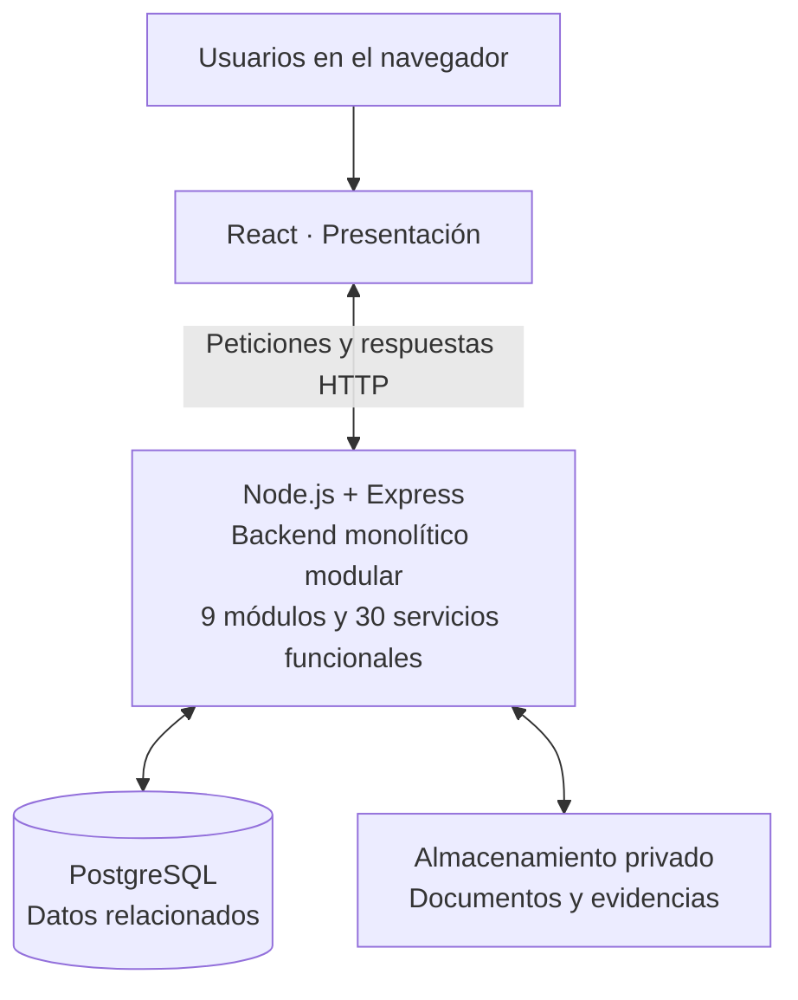

# Propuesta de solución por módulos — SGD PROBOSQUE

Clasificación funcional propuesta de las **30 necesidades de prioridad Alta o Media de las etapas 1 a 9**. Cada necesidad tiene un módulo principal y puede compartir información con otros módulos. El cruce relaciona necesidad, programa y fuente citada en la columna Origen de [TABLA_NECESIDADES.md](../TABLA_NECESIDADES.md#3-tabla-maestra).

Fecha de elaboración: 22 de noviembre de 2026.

## 1. Cuadro sinóptico de los 9 módulos

El expediente se comparte entre módulos. Contratos, minutas, comprobantes y resultados se vinculan con el expediente del predio correspondiente.

## 2. Programas y ámbitos

| Sigla | Programa |
|---|---|
| PSAH | Pago por Servicios Ambientales Hidrológicos |
| RHF | Restauración Hidrológico-Forestal |
| CC | Capturando Carbono |
| PS | Plantaciones Sustentables |
| MFS | Manejo Forestal Sustentable |
| PEG | Programa Estatal de Guardabosques |

La tabla de necesidades actual trata RFI (Restauración Forestal Integral) como modalidad de RHF. Las funciones de UIPPE y la evaluación del programa presupuestario tienen un ámbito institucional propio.

## 3. Propuesta de solución y construcción general

Se propone una aplicación web con nueve módulos. Los componentes tecnológicos se expresan de forma general para definir su función antes de seleccionar herramientas específicas.

| Módulo | Propuesta de solución | Cómo se hará, en términos generales |
|---|---|---|
| **1. Convocatorias y recepción de solicitudes** | Publicar requisitos, registrar solicitudes, emitir acuses y controlar faltantes. | **Formularios web** para capturar solicitudes y comprobar requisitos; **base de datos relacional** para relacionar programas, convocatorias, solicitudes y documentos; **generación de documentos** para emitir acuses. |
| **2. Expedientes y archivo documental** | Integrar, actualizar, conservar y consultar expedientes. | **Base de datos relacional** para vincular predios, personas, solicitudes y documentos; **almacenamiento de archivos** para documentos digitalizados y sus versiones; **consultas y filtros** para localizar expedientes. |
| **3. Notificaciones y seguimiento de respuestas** | Registrar avisos, entregas, respuestas y plazos. | **Flujo de seguimiento** con estados y fechas; **base de datos relacional** para conservar notificaciones y respuestas; **servicio de avisos** para informar pendientes y vencimientos; almacenamiento de constancias de entrega. |
| **4. Evaluación y resolución de solicitudes** | Elaborar dictámenes, organizar listas de espera e integrar la documentación para los órganos decisores. | **Formularios de evaluación** y **reglas configurables por programa**; **base de datos relacional** para criterios, dictámenes y resultados de evaluación; **generación de documentos** para dictámenes y paquetes de sesión. |
| **5. Contratos y control de recursos económicos** | Preparar contratos y dar seguimiento a pagos, cobros, reintegros y reasignaciones. | **Generación de documentos desde formatos autorizados**; **base de datos relacional con transacciones** para mantener consistentes los movimientos económicos; **reglas de cálculo y comprobación** por programa; conciliación de montos y comprobantes. |
| **6. Verificación en campo y conclusión del apoyo** | Documentar visitas, evidencias y conclusión del apoyo. | **Formularios web adaptables a dispositivos móviles**, consulta del expediente, **carga de archivos** y **flujo de revisión** de resultados y documentos firmados. |
| **7. Incumplimientos y restricciones de acceso a apoyos** | Registrar incumplimientos y administrar el listado de personas y predios restringidos. | **Base de datos relacional** para causales, evidencias, acuerdos y restricciones; **comprobaciones durante la recepción y los pagos**; historial de altas y exclusiones. |
| **8. Resultados, padrones e informes institucionales** | Consolidar resultados, mantener padrones y controlar entregas de información. | **Consultas y agregación de datos** por ejercicio, programa y región; conservación de cortes fechados; **generación y exportación de informes** y seguimiento de su aprobación y entrega. |
| **9. Auditoría y evaluación externa** | Consultar la trazabilidad del apoyo y atender hallazgos. | **Historial de operaciones** relacionado con el expediente; **consultas de trazabilidad**; preparación de paquetes documentales y seguimiento de responsables, plazos y evidencias de atención. |

Toda la aplicación compartiría una **base de datos relacional**, **almacenamiento documental** y **control de acceso por usuarios y roles**.

## 4. Correspondencia entre módulos, necesidades y programas

Las referencias de la última columna reproducen las que actualmente aparecen en Origen. Cada página se refiere al PDF indicado, salvo mención expresa de la Gaceta. Las menciones de programas en los análisis del equipo indican procedencia; cada condición requiere respaldo en su fuente primaria.

| Módulo | Necesidad | Programa o ámbito de procedencia | Evidencia citada en Origen |
|---|---|---|---|
| **1. Convocatorias y recepción** | **NG-001 · Conocer convocatoria y requisitos** | Los seis programas | Convocatoria 2026, pp. 8–10; solicitud FO-PB-501A. |
| | **NG-002 · Entregar la solicitud y obtener constancia** | Convocatoria común a los programas | Convocatoria, p. 9, base Cuarta; comprobante del FO-PB-501A. |
| | **NG-003 · Validar la entrega** | PSAH, RHF, CC, PS y MFS; recepción común de la convocatoria | RO-PSAH, pp. 10–12 y 19; referencias equivalentes de las otras cuatro reglas. |
| **2. Expedientes y archivo** | **NG-005 · Archivar y consultar expedientes** | PSAH y CC; también gestión archivística institucional | RO-PSAH, pp. 11–12, 19 y 21; RO-CC, pp. 5 y 8; instrumentos archivísticos. |
| | **NG-064 · Actualizar el expediente** | PSAH | RO-PSAH, pp. 11–12 y 17, cambios de representación y fallecimiento. |
| **3. Notificaciones** | **NG-065 · Notificar actualizaciones del trámite** | PSAH | RO-PSAH, p. 19, §10.1, fracciones III y VI. |
| | **NG-R08 · Notificar incumplimientos** | PSAH | RO-PSAH, pp. 16–17, obligaciones, suspensión y bajas. |
| **4. Evaluación y resolución** | **NG-007 · Emitir dictamen jurídico** | Principalmente PSAH; referencias complementarias de CC | RO-PSAH, pp. 4, 10–12 y 19–20; RO-CC, pp. 6–9. |
| | **NG-016 · Emitir dictamen técnico uniforme** | PSAH; MFS aparece como procedencia del análisis | RO-PSAH, pp. 8–9. El criterio de «desempate» atribuido a MFS está pendiente de respaldo. |
| | **NG-019 · Aplicar prelación y ordenar lista de espera** | Lista de espera común; criterios específicos de PSAH | Convocatoria, base Sexta; RO-PSAH, p. 12, §8.1.2. |
| | **NG-024 · Entregar documentación a los órganos decisores** | PSAH, CC y PS; también Consejo Directivo | RO-PSAH, p. 19; reglamentos de comités CC y PS; Manual de Organización. |
| **5. Contratos y recursos económicos** | **NG-029 · Formalizar contratos** | Los seis programas | Convocatoria y reglas de PSAH, RHF, CC, PS, MFS y PEG; requisitos contractuales y bancarios. |
| | **NG-025 · Dispersar ministraciones** | PSAH, RHF, CC, PS y PEG | Reglas sobre pagos de esos programas y Manual de Contabilidad. MFS requiere precisar su regla particular de pago para este cruce. |
| | **NG-066 · Controlar requisitos para ministraciones** | Los seis programas | La fila distingue requisitos de campo y gabinete para PSAH, RHF, CC, PS, MFS y PEG. |
| | **NG-R06 · Confirmar recepción y cobro** | PSAH y PEG; referencias complementarias de CC para reintegros | RO-PSAH, p. 4 y §10.1; RO-PEG, p. 13, §10.1 XV. |
| | **NG-032 · Tramitar reintegros** | PSAH y CC | RO-PSAH, p. 17, §8.1.9.3; RO-CC, p. 15, §8.1.9.c. |
| | **NG-033 · Reasignar recursos no ejercidos** | Reasignación común de la convocatoria; detalle de PSAH | Convocatoria, p. 11, base Sexta; RO-PSAH, pp. 17 y 20. |
| **6. Verificación y conclusión** | **NG-008 · Registrar visitas de verificación** | PSAH, RHF/RFI, CC y PS; referencias de supervisión de MFS y PEG | Reglas de cada programa. MFS y PEG tienen diferencias respecto a los documentos de las visitas. |
| | **NG-018 · Revisar resultados y evidencias de visitas** | PSAH | RO-PSAH, pp. 19–20, verificación y supervisión. |
| | **NG-067 · Informar la conclusión de actividades** | PSAH y CC para informe final; RHF y PS para conclusión de actividades | RO-PSAH, p. 16; RO-CC, pp. 7–8; RO-RHF, p. 6; RO-PS, p. 7. |
| | **NG-068 · Dar por concluido el apoyo** | PSAH, RHF, CC, PS y MFS | Apartado §8.2, «Graduación», de las cinco reglas. |
| **7. Incumplimientos** | **NG-030 · Asentar incumplimientos y evidencia** | PSAH | RO-PSAH, pp. 7, 17 y 21. |
| | **NG-031 · Impedir apoyos a personas restringidas** | PSAH y CC con citas expresas; PS, MFS y RFI aparecen en los análisis de procedencia | RO-PSAH, pp. 9–10 y 20–21; RO-CC, p. 15; listado de incumplidos. |
| | **NG-R13 · Administrar el listado de incumplidos** | PSAH y CC | RO-PSAH, p. 17; RO-CC, p. 15, reglas de exclusión del listado. |
| **8. Resultados y padrones** | **NG-034 · Reunir cifras de ejecución** | PSAH como evidencia específica; estadística institucional de programas | RO-PSAH, p. 20, §16.1; listado PSAH; funciones de UIPPE. |
| | **NG-037 · Presentar avances y resultados** | Programas de la Dirección de Restauración y Fomento Forestal | Manual de Organización, p. 25; ficha de indicador. |
| | **NG-038 · Controlar entregas de información** | Institucional, a través de UIPPE | Manual de Organización, pp. 16–17; reportes financieros y de ayudas y subsidios. |
| | **NG-069 · Integrar padrón final** | PSAH, RHF, CC, PS y MFS | Apartado §8.1.5 de las cinco reglas y lineamientos de padrones. |
| **9. Auditoría y evaluación** | **NG-036 · Dar seguimiento a evaluaciones externas** | Programa presupuestario Desarrollo Forestal | Evaluación CONAC 2023, términos de referencia y convenios de seguimiento. |
| | **NG-039 · Auditar resultados y ruta del recurso** | PSAH y CC como evidencia específica; fiscalización institucional | RO-PSAH, §17 y disposiciones de pagos y reintegros; RO-CC, p. 15; información financiera. |

## 5. Servicios funcionales por módulo

Cada servicio agrupa acciones que satisfacen una o varias necesidades y comparte los datos del expediente con los demás servicios.

| Módulo | Servicio propuesto | Qué permite hacer | Necesidades satisfechas |
|---|---|---|---|
| **1. Convocatorias y recepción** | **Consulta de convocatorias y requisitos** | Consultar programas, requisitos, oficinas receptoras y fechas de recepción. | NG-001 |
| | **Recepción de solicitudes y emisión de acuses** | Registrar la entrega y generar una constancia de los documentos recibidos. | NG-002 |
| | **Validación e integración de solicitudes** | Comprobar requisitos, registrar cotejos y faltantes, controlar la complementación y turnar el expediente integrado. | NG-003 |
| **2. Expedientes y archivo** | **Archivo y consulta de expedientes** | Clasificar, conservar y localizar expedientes actuales e históricos, con sus documentos y relaciones. | NG-005 |
| | **Actualización del expediente** | Incorporar cambios de representación, titularidad y documentación, conservando sus antecedentes. | NG-064 |
| **3. Notificaciones** | **Notificación del estado del trámite** | Comunicar faltantes y resoluciones, registrar entregas y controlar respuestas y plazos. | NG-065 |
| | **Notificación de incumplimientos** | Comunicar los hechos y motivos del incumplimiento y conservar la constancia correspondiente. | NG-R08 |
| **4. Evaluación y resolución** | **Dictaminación jurídica** | Revisar la documentación legal y asentar si la solicitud procede, con sus fundamentos y motivos. | NG-007 |
| | **Dictaminación técnica** | Aplicar los criterios técnicos del programa y documentar la elegibilidad del predio. | NG-016 |
| | **Prelación y lista de espera** | Organizar las solicitudes factibles conforme a los criterios y autorizaciones aplicables. | NG-019 |
| | **Integración de documentación para sesiones** | Reunir y entregar avisos, dictámenes, informes y anexos a los órganos decisores. | NG-024 |
| **5. Contratos y recursos económicos** | **Formalización de contratos** | Preparar contratos, gestionar su validación y firma y conservar los datos bancarios correspondientes. | NG-029 |
| | **Control de requisitos de ministración** | Registrar qué comprobantes se recibieron y cuáles están pendientes antes de solicitar cada pago. | NG-066 |
| | **Tramitación de ministraciones** | Calcular montos conforme al programa, preparar solicitudes y registrar la emisión del pago. | NG-025 |
| | **Confirmación de recepción y cobro** | Incorporar el acuse o confirmación de que la persona recibió y cobró el apoyo. | NG-R06 |
| | **Gestión de reintegros** | Tramitar la devolución autorizada y registrar cuenta, monto, fecha y comprobante. | NG-032 |
| | **Reasignación de recursos** | Relacionar los montos disponibles con solicitudes factibles y documentar la reasignación autorizada. | NG-033 |
| **6. Verificación y conclusión** | **Recepción del aviso e informe de conclusión** | Recibir el aviso de término y los documentos que acreditan las actividades realizadas. | NG-067 |
| | **Registro de verificaciones en campo** | Documentar cada visita con el formato correspondiente, resultados, firmas y evidencias. | NG-008 |
| | **Revisión de resultados de las verificaciones** | Consultar y revisar los resultados y las evidencias de las visitas para la supervisión. | NG-018 |
| | **Conclusión del apoyo** | Comprobar y asentar el cumplimiento total o con ajuste y registrar la graduación correspondiente. | NG-068 |
| **7. Incumplimientos** | **Registro de incumplimientos y evidencias** | Asentar qué se detectó, cuándo, bajo qué causal y con qué documentos de respaldo. | NG-030 |
| | **Administración del listado de incumplidos** | Registrar altas y solicitudes de exclusión con sus acuerdos y comprobantes. | NG-R13 |
| | **Comprobación de restricciones** | Advertir sobre personas o predios restringidos al revisar solicitudes y tramitar recursos. | NG-031 |
| **8. Resultados y padrones** | **Consolidación de cifras de ejecución** | Reunir superficies, montos y cumplimiento por ejercicio, programa y persona beneficiaria. | NG-034 |
| | **Presentación y validación de resultados** | Preparar avances y resultados para su revisión y aprobación por la Dirección General. | NG-037 |
| | **Control de entregas institucionales** | Registrar requerimientos, información entregada, destinatarios y fechas. | NG-038 |
| | **Integración y actualización de padrones** | Mantener la relación final de personas que recibieron apoyos y preparar su consulta y entrega. | NG-069 |
| **9. Auditoría y evaluación** | **Consulta de trazabilidad y evidencia para auditoría** | Recorrer la documentación desde la ministración hasta el resultado publicado y preparar la evidencia solicitada. | NG-039 |
| | **Seguimiento de evaluaciones externas** | Registrar responsables, entregas de información, hallazgos y comprobantes de atención. | NG-036 |

Esta primera distribución contiene **30 servicios funcionales para las 30 necesidades**. Los servicios se relacionan entre sí. Control de requisitos de ministración consulta contratos y verificaciones, mientras que Consulta de trazabilidad y evidencia para auditoría reúne la evidencia generada durante el trámite.

La correspondencia uno a uno facilita revisar la cobertura inicial. La agrupación posterior de servicios dependerá de que compartan una misma finalidad y responsable.

## 6. Relación entre propuesta de solución y servicios

El cruce se realiza por módulo entre la propuesta de solución de la sección 3 y los servicios funcionales de la sección 5. La propuesta y la forma de construcción se presentan una vez por módulo y aplican a los servicios de sus filas siguientes.

| Módulo | Propuesta de solución | Cómo se hará | Servicio | Necesidad satisfecha |
|---|---|---|---|---|
| **1. Convocatorias y recepción de solicitudes** | Publicar requisitos, registrar solicitudes, emitir acuses y controlar faltantes. | **Formularios web** para capturar solicitudes y comprobar requisitos; **base de datos relacional** para relacionar programas, convocatorias, solicitudes y documentos; **generación de documentos** para emitir acuses. | **Consulta de convocatorias y requisitos** | NG-001 |
|  |  |  | **Recepción de solicitudes y emisión de acuses** | NG-002 |
|  |  |  | **Validación e integración de solicitudes** | NG-003 |
| **2. Expedientes y archivo documental** | Integrar, actualizar, conservar y consultar expedientes. | **Base de datos relacional** para vincular predios, personas, solicitudes y documentos; **almacenamiento de archivos** para documentos digitalizados y sus versiones; **consultas y filtros** para localizar expedientes. | **Archivo y consulta de expedientes** | NG-005 |
|  |  |  | **Actualización del expediente** | NG-064 |
| **3. Notificaciones y seguimiento de respuestas** | Registrar avisos, entregas, respuestas y plazos. | **Flujo de seguimiento** con estados y fechas; **base de datos relacional** para conservar notificaciones y respuestas; **servicio de avisos** para informar pendientes y vencimientos; almacenamiento de constancias de entrega. | **Notificación del estado del trámite** | NG-065 |
|  |  |  | **Notificación de incumplimientos** | NG-R08 |
| **4. Evaluación y resolución de solicitudes** | Elaborar dictámenes, organizar listas de espera e integrar la documentación para los órganos decisores. | **Formularios de evaluación** y **reglas configurables por programa**; **base de datos relacional** para criterios, dictámenes y resultados de evaluación; **generación de documentos** para dictámenes y paquetes de sesión. | **Dictaminación jurídica** | NG-007 |
|  |  |  | **Dictaminación técnica** | NG-016 |
|  |  |  | **Prelación y lista de espera** | NG-019 |
|  |  |  | **Integración de documentación para sesiones** | NG-024 |
| **5. Contratos y control de recursos económicos** | Preparar contratos y dar seguimiento a pagos, cobros, reintegros y reasignaciones. | **Generación de documentos desde formatos autorizados**; **base de datos relacional con transacciones** para mantener consistentes los movimientos económicos; **reglas de cálculo y comprobación** por programa; conciliación de montos y comprobantes. | **Formalización de contratos** | NG-029 |
|  |  |  | **Control de requisitos de ministración** | NG-066 |
|  |  |  | **Tramitación de ministraciones** | NG-025 |
|  |  |  | **Confirmación de recepción y cobro** | NG-R06 |
|  |  |  | **Gestión de reintegros** | NG-032 |
|  |  |  | **Reasignación de recursos** | NG-033 |
| **6. Verificación en campo y conclusión del apoyo** | Documentar visitas, evidencias y conclusión del apoyo. | **Formularios web adaptables a dispositivos móviles**, consulta del expediente, **carga de archivos** y **flujo de revisión** de resultados y documentos firmados. | **Recepción del aviso e informe de conclusión** | NG-067 |
|  |  |  | **Registro de verificaciones en campo** | NG-008 |
|  |  |  | **Revisión de resultados de las verificaciones** | NG-018 |
|  |  |  | **Conclusión del apoyo** | NG-068 |
| **7. Incumplimientos y restricciones de acceso a apoyos** | Registrar incumplimientos y administrar el listado de personas y predios restringidos. | **Base de datos relacional** para causales, evidencias, acuerdos y restricciones; **comprobaciones durante la recepción y los pagos**; historial de altas y exclusiones. | **Registro de incumplimientos y evidencias** | NG-030 |
|  |  |  | **Administración del listado de incumplidos** | NG-R13 |
|  |  |  | **Comprobación de restricciones** | NG-031 |
| **8. Resultados, padrones e informes institucionales** | Consolidar resultados, mantener padrones y controlar entregas de información. | **Consultas y agregación de datos** por ejercicio, programa y región; conservación de cortes fechados; **generación y exportación de informes** y seguimiento de su aprobación y entrega. | **Consolidación de cifras de ejecución** | NG-034 |
|  |  |  | **Presentación y validación de resultados** | NG-037 |
|  |  |  | **Control de entregas institucionales** | NG-038 |
|  |  |  | **Integración y actualización de padrones** | NG-069 |
| **9. Auditoría y evaluación externa** | Consultar la trazabilidad del apoyo y atender hallazgos. | **Historial de operaciones** relacionado con el expediente; **consultas de trazabilidad**; preparación de paquetes documentales y seguimiento de responsables, plazos y evidencias de atención. | **Consulta de trazabilidad y evidencia para auditoría** | NG-039 |
|  |  |  | **Seguimiento de evaluaciones externas** | NG-036 |

El resultado comprende **9 módulos, 30 servicios y 30 necesidades**.

## 7. Herramientas específicas por módulo y servicio

La base propuesta es React para las pantallas, Node.js con Express para procesar las operaciones y PostgreSQL para almacenar y relacionar los datos. Las validaciones y permisos se comprobarían en el servidor.

| Módulo | Cómo se hará | Servicio y necesidad | Herramientas específicas propuestas |
|---|---|---|---|
| **1. Convocatorias y recepción** | Consultar convocatorias, requisitos, oficinas y fechas mediante pantallas web. | **Consulta de convocatorias y requisitos** · NG-001 | React para pantallas y filtros; Node.js + Express para consultas; PostgreSQL para convocatorias y requisitos. |
|  | Capturar la entrega y generar el comprobante con los documentos recibidos. | **Recepción de solicitudes y emisión de acuses** · NG-002 | React para formularios; Node.js + Express para recepción; PostgreSQL para datos; Puppeteer para generar el acuse PDF. |
|  | Comprobar requisitos y controlar faltantes, plazos y turnos. | **Validación e integración de solicitudes** · NG-003 | React para listas de comprobación; Node.js + Express para reglas y cambios de estado; PostgreSQL para requisitos, fechas y responsables. |
| **2. Expedientes y archivo** | Clasificar documentos, conservar versiones y localizar expedientes. | **Archivo y consulta de expedientes** · NG-005 | React para búsquedas y consulta; Node.js + Express para permisos y descargas; PostgreSQL para metadatos; Multer para recibir archivos y almacenamiento privado del servidor para conservarlos. |
|  | Incorporar cambios de representación, titularidad y documentación. | **Actualización del expediente** · NG-064 | React para edición y carga; Node.js + Express para validaciones; PostgreSQL para antecedentes; Multer para documentos de respaldo. |
| **3. Notificaciones** | Preparar avisos y registrar destinatario, entrega, respuesta y plazo. | **Notificación del estado del trámite** · NG-065 | React para bandeja de avisos; Node.js + Express para seguimiento; PostgreSQL para estados; Nodemailer para correo por SMTP; Puppeteer para avisos PDF. |
|  | Comunicar el incumplimiento y conservar sus motivos y constancia. | **Notificación de incumplimientos** · NG-R08 | React, Node.js + Express y PostgreSQL para seguimiento; Nodemailer cuando corresponda correo; Multer para constancias de entrega. |
| **4. Evaluación y resolución** | Revisar documentos legales y registrar el dictamen y sus motivos. | **Dictaminación jurídica** · NG-007 | React para consulta documental y evaluación; Node.js + Express para flujo de revisión; PostgreSQL para dictámenes; Docxtemplater para preparar Word desde formatos autorizados. |
|  | Aplicar los criterios técnicos vigentes de cada programa. | **Dictaminación técnica** · NG-016 | React para formularios; Node.js + Express para comprobaciones y cálculos; PostgreSQL para criterios y resultados; Docxtemplater para el dictamen. |
|  | Ordenar solicitudes con los criterios documentados y registrar la autorización. | **Prelación y lista de espera** · NG-019 | PostgreSQL para consultas y ordenamiento; Node.js + Express para reglas por programa; React para revisión; ExcelJS para exportar listas. |
|  | Reunir y entregar dictámenes, informes y anexos para sesiones. | **Integración de documentación para sesiones** · NG-024 | React para seleccionar documentos; PostgreSQL para relacionarlos con la sesión; Archiver para paquetes ZIP; Puppeteer para la relación de documentos. |
| **5. Contratos y recursos económicos** | Completar formatos con datos del expediente y gestionar validación y firma. | **Formalización de contratos** · NG-029 | React para revisión; Node.js + Express para recuperar datos; PostgreSQL para contratos y datos bancarios; Docxtemplater para Word; Multer para incorporar ejemplares firmados. |
|  | Mostrar qué comprobantes se recibieron y cuáles faltan por ministración. | **Control de requisitos de ministración** · NG-066 | React para listas y estados; Node.js + Express para comprobaciones; PostgreSQL para requisitos por programa; Multer para comprobantes. |
|  | Calcular montos, preparar solicitudes y registrar la emisión del pago. | **Tramitación de ministraciones** · NG-025 | Node.js + Express para reglas; PostgreSQL, con montos decimales y transacciones, para movimientos; React para revisión; Puppeteer para solicitudes PDF. |
|  | Registrar la confirmación de recepción y cobro con su evidencia. | **Confirmación de recepción y cobro** · NG-R06 | React para captura; Node.js + Express para comprobaciones; PostgreSQL para fecha, monto y referencia; Multer para acuses. |
|  | Registrar la devolución autorizada y conciliar el importe reintegrado. | **Gestión de reintegros** · NG-032 | React para seguimiento; Node.js + Express para flujo; PostgreSQL para movimientos relacionados; Multer para comprobantes; ExcelJS para conciliación. |
|  | Relacionar recursos disponibles con solicitudes factibles y su autorización. | **Reasignación de recursos** · NG-033 | React para revisión; Node.js + Express para comprobar condiciones; PostgreSQL con transacciones para actualizar saldos y asignaciones conjuntamente. |
| **6. Verificación y conclusión** | Recibir el aviso de término y los documentos de conclusión. | **Recepción del aviso e informe de conclusión** · NG-067 | React para formularios; Node.js + Express para recepción; PostgreSQL para fechas y estados; Multer para informes. |
|  | Capturar resultados de visitas y adjuntar formatos firmados y evidencias. | **Registro de verificaciones en campo** · NG-008 | React con diseño adaptable a móviles; Node.js + Express para captura; PostgreSQL para visitas; Multer para fotografías y minutas; Docxtemplater para formatos autorizados. |
|  | Consultar resultados y evidencias y registrar su revisión. | **Revisión de resultados de las verificaciones** · NG-018 | React para consulta; Node.js + Express para permisos y revisión; PostgreSQL para resultados, observaciones y responsables. |
|  | Comprobar y asentar la conclusión total o con ajuste. | **Conclusión del apoyo** · NG-068 | React para revisión del cumplimiento; Node.js + Express para comprobar condiciones; PostgreSQL para cierre y antecedentes; Puppeteer para la constancia, cuando su formato se confirme. |
| **7. Incumplimientos** | Registrar hechos, causal, fecha y documentos de respaldo. | **Registro de incumplimientos y evidencias** · NG-030 | React para captura; Node.js + Express para validación; PostgreSQL para incumplimientos; Multer para evidencias. |
|  | Incorporar altas y solicitudes de exclusión con sus antecedentes. | **Administración del listado de incumplidos** · NG-R13 | React para administración; Node.js + Express para permisos y cambios de estado; PostgreSQL para historial; Multer para documentos probatorios. |
|  | Consultar restricciones al revisar solicitudes y tramitar pagos. | **Comprobación de restricciones** · NG-031 | PostgreSQL para cruces de personas y predios; Node.js + Express para comprobaciones; React para mostrar advertencias y sus motivos. |
| **8. Resultados y padrones** | Reunir superficies, montos y cumplimiento por ejercicio y programa. | **Consolidación de cifras de ejecución** · NG-034 | PostgreSQL para agregaciones; Node.js + Express para consultas; React para filtros y tablas; ExcelJS para exportaciones. |
|  | Preparar resultados y registrar su revisión y aprobación. | **Presentación y validación de resultados** · NG-037 | React para revisión; Node.js + Express para el flujo de aprobación; PostgreSQL para cortes y versiones; Puppeteer para informes PDF. |
|  | Conservar qué información se solicitó, entregó y cuándo. | **Control de entregas institucionales** · NG-038 | React para seguimiento; Node.js + Express para operaciones; PostgreSQL para solicitudes y entregas; Multer para constancias y archivos entregados. |
|  | Mantener y exportar la relación final de personas beneficiarias. | **Integración y actualización de padrones** · NG-069 | PostgreSQL para consultar beneficiarios y estados; Node.js + Express para comprobaciones; React para revisión; ExcelJS para Excel y Puppeteer para PDF. |
| **9. Auditoría y evaluación** | Recorrer la evidencia del apoyo y preparar paquetes documentales. | **Consulta de trazabilidad y evidencia para auditoría** · NG-039 | PostgreSQL para relaciones e historial; Node.js + Express para consultas autorizadas; React para consulta cronológica; Archiver para ZIP; ExcelJS para la relación de evidencias. |
|  | Registrar evaluaciones, responsables, hallazgos y evidencias de atención. | **Seguimiento de evaluaciones externas** · NG-036 | React para seguimiento; Node.js + Express para estados y permisos; PostgreSQL para hallazgos y plazos; Multer para evidencias; Puppeteer para informes. |

Multer recibe los archivos enviados desde los formularios. Su conservación se resolvería mediante almacenamiento privado, con sus ubicaciones y versiones relacionadas en PostgreSQL. Docxtemplater completa documentos Word desde plantillas y Puppeteer genera los PDF desde documentos HTML diseñados para impresión.

ExcelJS permitiría preparar archivos Excel, Archiver reunir documentos en ZIP y Nodemailer enviar correo mediante un servicio SMTP configurado. Las constancias de entrega seguirían formando parte del expediente.

### Referencias técnicas

- [React — interfaces web](https://react.dev/).
- [Node.js — entorno de ejecución de JavaScript](https://nodejs.org/en/learn/getting-started/introduction-to-nodejs).
- [Express — framework web para Node.js](https://expressjs.com/).
- [PostgreSQL — transacciones](https://www.postgresql.org/docs/current/tutorial-transactions.html).
- [Multer — recepción de archivos enviados por formularios](https://github.com/expressjs/multer).
- [Docxtemplater — documentos Word desde plantillas](https://docxtemplater.com/docs/).
- [Puppeteer — generación de PDF](https://pptr.dev/guides/pdf-generation).
- [ExcelJS — lectura y escritura de Excel](https://github.com/exceljs/exceljs).
- [Archiver — generación de archivos comprimidos](https://www.archiverjs.com/).
- [Nodemailer — envío de correo electrónico](https://nodemailer.com/).

## 8. Descripción y funcionamiento de las herramientas

| Herramienta | Qué es y dónde funciona | Cómo funciona | Uso propuesto en el SGD |
|---|---|---|---|
| **React** | Librería de JavaScript para construir interfaces en el navegador. | Organiza las pantallas en componentes que muestran datos y responden a las acciones del usuario. Envía solicitudes al servidor para consultar o guardar información. | Formularios, búsquedas, tablas, listas de comprobación y pantallas de seguimiento. [Documentación](https://react.dev/) |
| **Node.js** | Entorno que ejecuta JavaScript en el servidor. | Ejecuta el código que recibe las peticiones de la aplicación, procesa operaciones, consulta datos y prepara respuestas. | Ejecutar las reglas y servicios de los nueve módulos. [Documentación](https://nodejs.org/en/learn/getting-started/introduction-to-nodejs) |
| **Express** | Framework web que funciona sobre Node.js. | Define rutas para operaciones como registrar una solicitud o consultar un expediente. Permite ejecutar comprobaciones de acceso y validaciones antes de atender cada operación. | Organizar la comunicación entre React, las reglas del negocio y la base de datos. [Documentación](https://expressjs.com/en/guide/using-middleware.html) |
| **PostgreSQL** | Sistema gestor de base de datos relacional, instalado en el servidor. | Conserva información en tablas relacionadas. Ejecuta consultas y transacciones para mantener consistentes operaciones que modifican varios datos. | Relacionar personas, predios, solicitudes, expedientes, pagos, visitas y documentos. [Documentación](https://www.postgresql.org/docs/current/intro-whatis.html) |
| **Multer** | Componente de procesamiento de peticiones —middleware— para Express y Node.js. | Procesa los archivos enviados desde formularios web y permite recibirlos en memoria o escribirlos en disco, según la configuración. | Recibir minutas, fotografías, contratos firmados, informes y comprobantes. La aplicación deberá relacionarlos con su expediente y controlar su conservación. [Documentación](https://github.com/expressjs/multer) |
| **Docxtemplater** | Librería de JavaScript que puede ejecutarse en Node.js. | Abre una plantilla Word con campos marcados y los sustituye por datos de la aplicación. Produce un archivo .docx. | Preparar contratos, dictámenes y otros documentos a partir de formatos autorizados. [Documentación](https://docxtemplater.com/docs/) |
| **Puppeteer** | Librería de JavaScript para controlar un navegador, normalmente desde Node.js. | Abre un documento HTML, aplica sus estilos y utiliza la función de impresión del navegador para generar un PDF. | Generar acuses, avisos, relaciones de documentos e informes PDF. [Documentación](https://pptr.dev/guides/pdf-generation) |
| **ExcelJS** | Librería de JavaScript para trabajar con archivos Excel desde Node.js. | Crea o lee libros de trabajo y permite manejar hojas, filas, celdas y formatos. | Exportar listas de espera, padrones, conciliaciones y resultados en .xlsx. [Documentación](https://github.com/exceljs/exceljs) |
| **Archiver** | Librería de Node.js para crear archivos comprimidos. | Reúne archivos y carpetas en un paquete, como un ZIP, que puede guardarse o enviarse para descarga. | Preparar paquetes documentales para sesiones, auditorías y evaluaciones. [Documentación](https://www.archiverjs.com/) |
| **Nodemailer** | Librería de Node.js para enviar correo electrónico. | Construye mensajes con destinatarios, contenido y adjuntos y los entrega mediante un servicio de correo configurado, por ejemplo SMTP. | Enviar avisos y documentos cuando el procedimiento permita ese medio. La aplicación conservaría el resultado del envío y la evidencia de entrega que corresponda. [Documentación](https://nodemailer.com/) |

El **almacenamiento privado de archivos** es otro componente de la solución. Su función sería conservar los documentos recibidos; PostgreSQL guardaría sus datos de identificación, ubicación y relación con el expediente. Su implementación concreta queda pendiente de elegir.

## 9. Arquitectura de la aplicación

Se propone una **arquitectura cliente-servidor de tres capas, con un backend monolítico modular**.

| Capa | Herramientas propuestas | Responsabilidad |
|---|---|---|
| **Presentación** | React | Mostrar pantallas, formularios, expedientes y resultados en el navegador. |
| **Lógica de negocio** | Node.js + Express | Procesar solicitudes, comprobar permisos, aplicar reglas de cada programa y ejecutar los servicios de los nueve módulos. |
| **Persistencia** | PostgreSQL y almacenamiento privado de archivos | Conservar datos relacionados, documentos, versiones y evidencias. |

Los nueve módulos estarían organizados dentro de una misma aplicación de servidor. Cada módulo tendría sus servicios y compartiría información del expediente.

Los **30 servicios** definidos son funciones del negocio, como recibir solicitudes o tramitar reintegros. Se implementarían dentro de los módulos del backend.

## 10. Fuentes de consulta

La trazabilidad completa, con páginas, numerales y vacíos por necesidad, se conserva en la columna Origen de la [tabla maestra](../TABLA_NECESIDADES.md#3-tabla-maestra).

- [Convocatoria 2026 de los Programas de Apoyo](../Comun/Programas%20de%20apoyo/CONVOCATORIA_2026_Programas_Apoyo.pdf).
- [Reglas de Operación del PSAH 2026](../Comun/Programas%20de%20apoyo/RO_2026_PagoServiciosAmbientales_Hidrológicos.pdf).
- [Reglas de Operación de RHF 2026](../Comun/Programas%20de%20apoyo/RO_2026_Restauración_Hidrológico-Forestal.pdf).
- [Reglas de Operación de CC 2026](../Comun/Programas%20de%20apoyo/RO_2026_CapturandoCarbono.pdf).
- [Reglas de Operación de PS 2026](../Comun/Programas%20de%20apoyo/RO_2026_PlantacionesSustentables.pdf).
- [Reglas de Operación de MFS 2026](../Comun/Programas%20de%20apoyo/RO_2026_ManejoForestalSustentable.pdf).
- [Manual General de Organización](../Comun/Manual%20Jurídico/dic161d.pdf).
