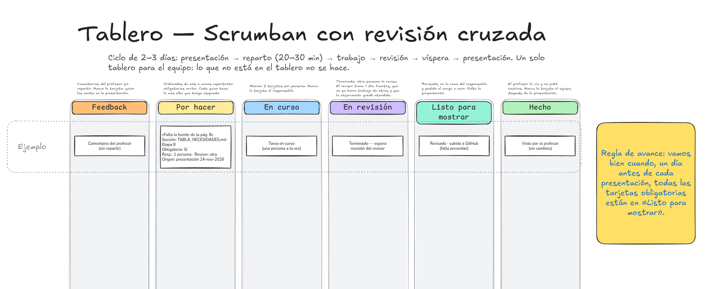

# Metodología de trabajo — Scrumban con revisión cruzada

Este documento explica cómo se reparte el trabajo, cómo sabemos si vamos bien y cómo registramos lo que pide el profesor. Él revisa cada 2–3 días y espera las correcciones de un día para otro. Somos 6 personas.

## 1. Qué usamos y por qué

Comparamos Scrum, Kanban, Scrumban, DSDM, XP y Crystal Clear. Ninguno funciona completo con ciclos de 2–3 días y cambios a mitad del trabajo, así que de cada uno tomamos solo lo que nos sirve.

| Método       | Qué tomamos                                                                                          | Qué dejamos y por qué                                                                                                          |
| ------------- | ----------------------------------------------------------------------------------------------------- | -------------------------------------------------------------------------------------------------------------------------------- |
| Kanban        | Tablero por columnas, límite de trabajo en curso y la columna de pendientes ordenada por importancia | El flujo sin fechas: necesitamos un momento fijo para repartir                                                                   |
| Scrum         | Ciclo corto que termina en una revisión; seguimiento diario breve                                    | Roles fijos y ciclo inamovible: no hay jerarquía real y el profesor reordena a mitad del ciclo                                  |
| DSDM          | Separar lo obligatorio de lo que puede esperar                                                        | Las cuatro categorías MoSCoW: casi todo lo que pide el profesor sería obligatorio y no aportan más que el orden de la columna |
| XP            | Revisión del trabajo por otra persona                                                                | Trabajo en parejas: con 6 personas reduce las tareas que avanzan a la vez                                                        |
| Crystal Clear | —                                                                                                    | Nada que no cubran los anteriores                                                                                                |

La combinación de Kanban con la cadencia de Scrum se llama **Scrumban**.

## 2. El tablero

Un solo tablero para todo el equipo. Lo que no está en el tablero no se hace.

| Columna            | Qué hay ahí                                                            | Quién mueve la tarjeta                 |
| ------------------ | ------------------------------------------------------------------------ | --------------------------------------- |
| Feedback           | Comentarios del profesor sin repartir                                    | Quien los anota en la presentación     |
| Por hacer          | Tarjetas con responsable, **ordenadas de más a menos importante** | El equipo, en el reparto                |
| En curso           | Máximo **2 tarjetas por persona**                                 | El responsable                          |
| En revisión       | Terminado; otra persona lo revisa                                        | El responsable                          |
| Listo para mostrar | Revisado y subido a GitHub, pendiente de la presentación                | El revisor                              |
| Hecho              | El profesor lo vio y no pidió cambios                                   | El equipo, después de la presentación |

**Orden de "Por hacer":** arriba van las tarjetas marcadas como **obligatorias** (lo que pidió el profesor para la próxima presentación); abajo, lo que puede esperar. Cada quien toma siempre la tarjeta más alta que tenga asignada.

### Ejemplo

## 3. El ciclo (cada 2–3 días)

1. **Presentación.** Cada comentario del profesor se anota en ese momento como tarjeta en Feedback.
2. **Reparto (20–30 min, justo después).** A cada tarjeta se le asigna la sección afectada, un solo responsable, un revisor distinto y si es obligatoria. Se ordena la columna "Por hacer".
3. **Trabajo.** Cada quien trabaja por su cuenta. Cada día manda un mensaje breve al grupo: qué hizo, qué hará y qué lo detiene.
4. **Revisión.** Al terminar, el responsable pasa la tarjeta a "En revisión" y avisa a su revisor. El revisor tiene **un día** para revisar fuentes, que no se haya borrado trabajo de otros y que la observación del profesor quedó atendida. Si encuentra algo, la tarjeta regresa a "En curso" con una nota.
5. **Víspera.** Se revisa el tablero: ¿todas las tarjetas obligatorias están en "Listo para mostrar"? Si no, se decide ahí quién apoya o qué se recorta, y se avisa antes de presentar.
6. **Presentación.** Lo aceptado pasa a Hecho; lo nuevo entra a Feedback.

Si algo salió mal (una entrega incumplida, un retrabajo), se dedican 10 minutos al final del reparto a ver por qué.

## 4. La tarjeta

| Campo                          | Ejemplo                           |
| ------------------------------ | --------------------------------- |
| Observación (textual y breve) | «Falta la fuente de la pág. 8» |
| Sección afectada              | `TABLA_NECESIDADES.md`, Etapa 8 |
| Obligatoria                    | Sí                               |
| Responsable                    | Una sola persona                  |
| Revisor                        | Otra persona                      |
| Origen                         | Presentación del 24-nov-2026     |

El estado de la tarjeta es la columna donde está; no se anota aparte.

## 5. La regla de avance

> **Vamos bien cuando, un día antes de cada presentación, todas las tarjetas obligatorias están en "Listo para mostrar".**

## 6. Integración en GitHub

Una tarjeta pasa a "Listo para mostrar" cuando el revisor la aprobó, su cambio está en la rama del responsable y se pidió integrarlo a `main`. Quien integra a `main` comprueba que el cambio no borre trabajo de otros antes de unirlo.
